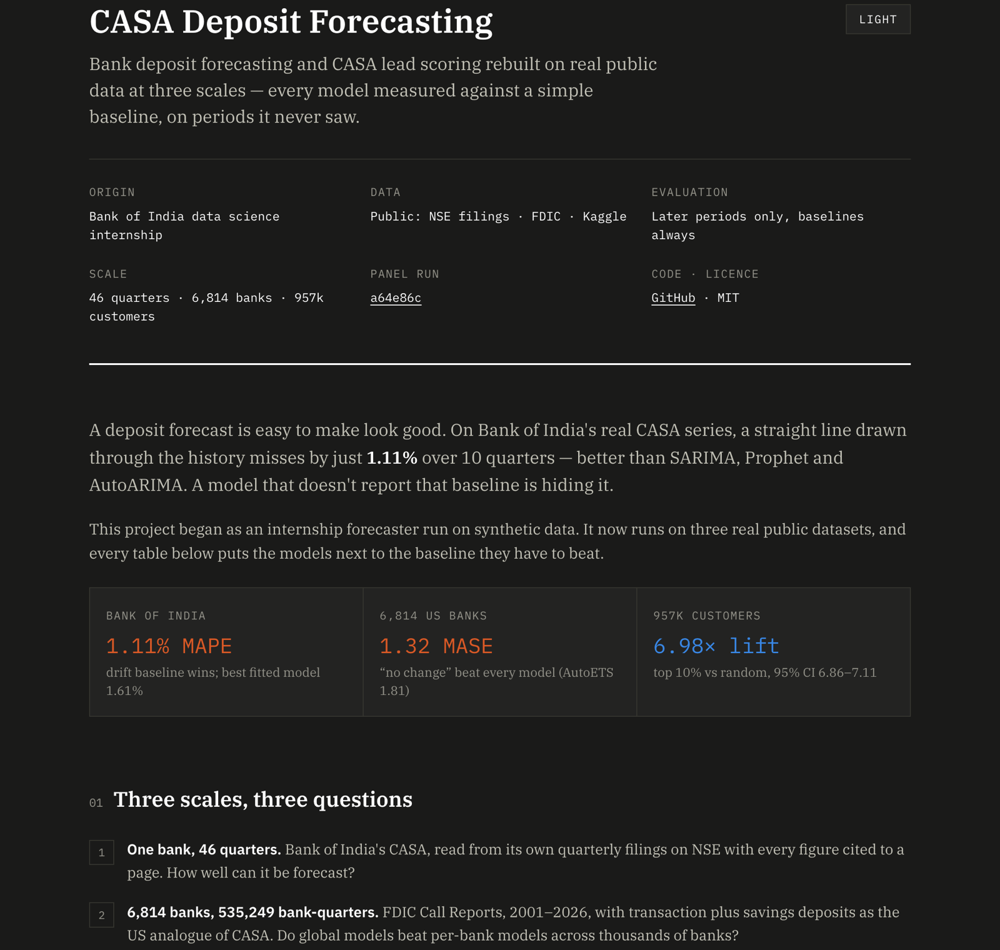

# CASA Deposit Forecasting: from a 40-row prototype to real data at scale

[](https://python.org)
[](web/)
[](tests/)

[](web/)

This project began during a Bank of India data science internship as a CASA (Current Account + Savings Account) deposit forecaster. Bank data was confidential, so the first version ran on a **synthetic, LLM-generated** 40-quarter series. This repository now runs the same ideas on **real public data at three scales**:

| Track | Data | Scale | Question |
|---|---|---|---|
| 0. Bank of India | BOI's own quarterly results filed with NSE | 46 quarters, 2015–2026 | How well can BOI's CASA be forecast? |
| B. US bank panel | FDIC Call Reports | 535,249 bank-quarters, 6,814 banks | Do global models beat per-bank models across thousands of banks? |
| A. Customer lead scoring | Santander Product Recommendation (Kaggle) | 13.6M customer-months, 956,645 customers | Which customers will open a CASA-type account next month? |

Every headline number below is measured on later time periods than the model was trained on, against simple baselines, with an uncertainty range where the sample allows. Leakage guards in `src/evaluation/temporal.py` raise if a split or feature reaches into the future.

## Results

### Track 0: Bank of India's real CASA series

`data/real/boi_casa_quarterly.csv`: 46 quarter-ends (Mar-2015 to Jun-2026), each row cited to the NSE filing and page it came from. Holdout: 10 quarters, 2024Q1–2026Q2.

| Model | MAPE | MASE |
|---|---:|---:|
| Drift (baseline) | **1.11%** | **0.18** |
| Global LightGBM trained on 6,814 FDIC banks, applied to BOI | 1.30% | — |
| Holt-Winters | 1.62% | 0.26 |
| SARIMA | 2.52% | 0.41 |
| Chronos-2 (zero-shot) | 2.58% | — |
| Prophet | 4.63% | 0.74 |
| Seasonal naive (baseline) | 9.18% | 1.49 |

A straight-line drift was the hardest model to beat on BOI. The model trained only on US banks beat every BOI-fitted statistical model except that baseline.

### Track B: 6,814 US banks (FDIC Call Reports, 2001–2026)

Target: transaction + savings deposits (`TRN + NTRSMMDA + NTRSOTH`), the US analogue of CASA. Backtest: 9 forecast origins (2021Q4–2023Q4), 1–4 quarters ahead, about 4,000 banks per origin (35,586 bank-origins). Failed banks such as SVB and Signature stay in the data, so there's no survivorship bias.

| Model | MASE (mean) | MASE (median) |
|---|---:|---:|
| Naive (no change) | **1.32** | **1.06** |
| AutoTheta | 1.68 | 1.42 |
| AutoETS | 1.81 | 1.54 |
| Chronos-2 (zero-shot) | 1.83 | 1.50 |
| Global LightGBM | 1.85 | 1.55 |
| Seasonal naive | 1.86 | 1.61 |

- **Trend-following models lost to "no change".** They learned from two decades of mostly rising deposits and the 2020–21 surge, then forecast growth just as the 2022–23 rate hikes reversed deposits. In the 2023Q1 outflow quarter (−$846bn industry-wide), one-step errors for the global LightGBM rose from MASE 0.89 to 1.51.
- **The global model ties per-bank AutoETS:** mean MASE difference +0.03, 95% CI −0.004 to +0.091 (bootstrap over banks). Its settings were chosen on 2019–2020 origins only, so the test period was never used for tuning.
- **Sum-of-banks check:** at one quarter ahead, summed bank forecasts miss the actual total by 2.2% for Naive and 3.3–3.8% for the models.

### Track A: CASA-acquisition lead scoring (Santander, 956,645 customers)

Target: the customer opens a CASA-type account next month that they did not hold this month (current, particular, e-account, payroll or savings; treating these as CASA is our reading of the product list). Train on Jun-2015 to Feb-2016, validate on Mar-2016, test on Apr-2016 features with May-2016 labels. The monthly base rate is about 1%.

| Evaluation | Customers | LightGBM lift @ top 10% (95% CI) | Logistic regression | Rule baseline |
|---|---:|---:|---:|---:|
| **Genuinely new adds** | 894,665 | **6.98 (6.86–7.11)** | 6.15 | 1.78 |
| All adds | 926,663 | 7.77 (7.69–7.86) | 7.02 | 1.90 |

37% of all adds were customers reopening an account they had held in the previous five months: easy to predict and worth little. The "genuinely new" row excludes them and is the honest headline. ROC AUC on new adds is 0.90. Kaggle states that this sample contains no real Santander customers.

## What I fixed

[docs/what-i-fixed.md](docs/what-i-fixed.md) has the before/after. In short:
- **SARIMAX used future data.** It forecast with the actual macro values of the test quarters. Inputs are now lagged by the forecast horizon.
- **ARIMA had no drift term**, so it forecast a flat line.
- **The drift monitor compared levels of a trending series**, so it always alarmed.
- **There were no baselines or significance tests.** Seasonal-naive and drift baselines, MASE and Diebold–Mariano tests are now included.

## Data provenance

| Data | Source | Real? | In git? |
|---|---|---|---|
| `data/raw/boi_casa_deposits.csv`, `macro_indicators.csv` | LLM-generated (ChatGPT) | **Synthetic.** Demo and test input only ([details](data/raw/README.md)) | Yes |
| `data/real/boi_casa_quarterly.csv` | Bank of India filings on NSE, each row cited | Real, public | Yes |
| FDIC Call Reports | `api.fdic.gov/banks/financials` | Real, public | No (`python run_panel_ingest.py`) |
| Santander Product Recommendation | Kaggle competition data | Public sample; no real customers per Kaggle | No (competition rules forbid redistribution) |

Research notes on each source are in [docs/research/](docs/research/).

## Reproduce

Use a native arm64 Python on Apple Silicon (PyTorch has no Intel-Mac builds).

```bash
python3 -m venv .venv && .venv/bin/pip install -r requirements.txt -r requirements-scale.txt
```

| Step | Command |
|---|---|
| BOI series from filings | `.venv/bin/python run_boi_real.py` |
| BOI forecasting | `.venv/bin/python run_pipeline.py --data data/real/boi_casa_quarterly.csv --out-dir data/processed/boi_real` |
| FDIC download and panel build | `.venv/bin/python run_panel_ingest.py` |
| Panel backtest | `.venv/bin/python run_panel.py`, then `--chronos-only` (Chronos runs in its own process) |
| Transfer to BOI | `.venv/bin/python run_panel.py --transfer`, then `--transfer --chronos-only` |
| Santander (accept the Kaggle rules first) | `kaggle competitions download -c santander-product-recommendation -p data/external/santander`, unzip, then `.venv/bin/python run_propensity.py` |
| Dashboard data | `.venv/bin/python scripts/export_web_data.py` |
| Tests | `.venv/bin/python -m pytest tests/` |

Each run writes its config, input-file hashes and git commit next to its results (`reports/panel/summary.json`, `reports/propensity/metrics.json`).

## Dashboard

`web/` is a single static results page (Next.js): the three tracks' headline numbers, an interactive chart per track (BOI forecast explorer, panel MASE by origin, lead-scoring call-capacity frontier), the evaluation protocol and how to reproduce. It shows committed results only; nothing is recomputed in the browser.

```bash
cd web && npm install && npm run dev
```

## Project structure

```text
src/evaluation/   metrics (MASE, Diebold-Mariano), lift with bootstrap CI, leakage guards
src/pipelines/    single-series forecasting pipeline (BOI and synthetic)
src/real_data/    BOI filings extraction
src/panel/        FDIC ingest and panel build
src/propensity/   Santander ingest, target and features
run_*.py          entry points
reports/          results: panel/, propensity/, and the synthetic-series reports
web/              Next.js dashboard
```

## Resume bullets

- Rebuilt a Bank of India CASA forecasting pipeline on 46 quarters of BOI's published CASA figures. Found and removed a look-ahead leak; a drift baseline led at 1.11% MAPE on a 10-quarter holdout, and a model trained on 6,814 US banks reached 1.30%, beating Holt-Winters (1.62%).
- Scaled deposit forecasting to 6,814 US banks (535k FDIC bank-quarters, 2001–2026) with statistical, global LightGBM and Chronos-2 models over 9 backtest origins. Showed that trend models lost to a no-change forecast through the 2022–23 deposit outflows (MASE 1.32 vs 1.68–1.85).
- Built CASA-acquisition lead scoring on Santander's public 13.6M-row, 957k-customer dataset. Achieved top-decile lift of 6.98 (95% CI 6.86–7.11) on genuinely new account openings, measured on a later month than training, vs 6.15 for logistic regression.
